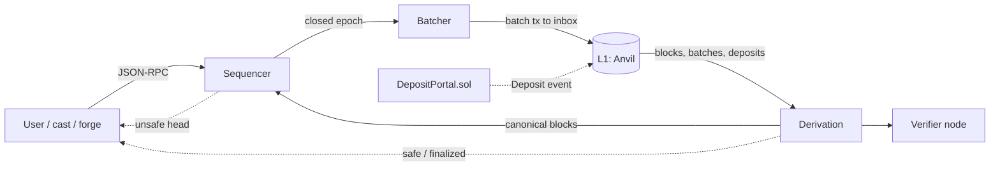

# go-mini-rollup

[](https://github.com/sergiiogg7/go-mini-rollup/actions/workflows/ci.yml)
[](LICENSE)

An educational **rollup in Go**: a sequencer, a batcher and a deterministic derivation that rebuilds the L2 chain from L1 data alone. It runs on a real Ethereum EVM (`go-ethereum` as a library) and uses a local **Anvil** as L1. It handles L1 reorgs, scheduled protocol upgrades (a "hard fork"), and malicious input, and it comes with a one-command demo.

> Lab project. Single sequencer, no fault or validity proofs, no withdrawals (see the `rollup-bridge` project), not audited, do not use with real value. See [SECURITY.md](SECURITY.md).

## What you can see in 3 minutes

```bash
scripts/demo.sh        # needs: go 1.27+, foundry (anvil, cast, forge)
```

Real recorded output is in [docs/DEMO.md](docs/DEMO.md). The demo:

1. deposits ETH on L1 and watches it appear on L2 (a forced, trustless mint),
2. sends an L2 transfer with plain `cast send`,
3. deploys and calls a Solidity contract on L2 (a real EVM),
4. shows `unsafe → safe → finalized` heads,
5. starts an **independent verifier** that only reads L1 and gets the **identical block hash**,
6. reorganizes L1 so a deposit disappears, and shows the L2 balance rolling back and both nodes converging,
7. prints Prometheus metrics (and with `scripts/observability-up.sh` a native Prometheus and Grafana scrape them, see [Monitoring](#monitoring)).

`KEEP=1 scripts/demo.sh` leaves everything running; open `http://127.0.0.1:19545/` for a live status page (heads, reorg counters, last blocks).

## How it works



- **Sequencer** (`internal/sequencer`): orders transactions and builds the *unsafe* chain. It is a preview, not the truth.
- **Batcher** (`internal/batcher`): publishes one compressed `EpochBatch` per closed epoch to an L1 inbox address. It survives crashes (it recovers its position by scanning L1), stuck transactions (fee bump) and L1 reorgs (it re-signs on top of the confirmed nonce).
- **Derivation** (`internal/derive`): reads **only L1** and deterministically rebuilds the canonical (*safe*) chain. If the sequencer disagrees, the sequencer converges to the derived chain and re-queues the transactions it lost.
- **Executor** (`internal/exec`): go-ethereum's real EVM, state trie and receipts. Same code path for sequencer and derivation, so both produce the same block hash.
- **Epoch**: one L1 block. Deposits of that L1 block are applied at the start of the epoch's first L2 block (forced inclusion), even if the sequencer disappears.

Rules, parameters and the fork schedule are in [docs/SPEC.md](docs/SPEC.md). Design decisions are in [docs/ADR.md](docs/ADR.md).

## Why a recruiter or tech lead might care

| Topic | Where to look |
|---|---|
| Sequencing, batch submission, derivation, safe/finalized heads | `internal/sequencer`, `internal/batcher`, `internal/derive` |
| Determinism and "invalid input never crashes the node" | adversarial table in `internal/derive/derive_test.go`, `FuzzDecodeBatch` |
| L1 reorgs | `TestRandomReorgScriptsConvergeToFreshDerivation` (60 random scripts), `internal/sim` |
| Protocol upgrade (hard fork) and what happens to a node that did not upgrade | `TestForkBoundaryAndOldNodeDiverges` |
| Real EVM and state | `internal/exec` (go-ethereum `core/vm`, MPT state root) |
| Operation | `/metrics`, Prometheus alert rules, Grafana dashboard ([docs/OBSERVABILITY.md](docs/OBSERVABILITY.md)), `/status` page, `rollup_syncStatus` RPC |
| Solidity | `contracts/` (Foundry: `DepositPortal`, tests, fuzz; Slither in CI) |
| Adapters tested for real | `internal/l1` against a real Anvil, `internal/rpcapi` over HTTP with go-ethereum's own client |

## Monitoring

The binary serves 25 documented metrics on `/metrics` (heads, derivation lag, batcher in-flight and resubmissions, accepted and rejected batches by reason, fallback epochs, pool size, L1 and unsafe reorgs, block build time). `monitoring/` has the Prometheus config, 8 alert rules and a provisioned Grafana dashboard; `scripts/observability-up.sh` starts both natively (no Docker) and `bin/obscheck` verifies them through their APIs. [docs/OBSERVABILITY.md](docs/OBSERVABILITY.md) has the real evidence, including three controlled failures (L1 stops mining, batcher without funds, two L1 reorgs) in which the alerts fired and resolved. No screenshots: the proof is API output.

## Build, test, run

```bash
go build -o bin/rollup ./cmd/rollup
go vet ./... && go test ./...                               # 58 tests (+32 subtests): property tests, end-to-end simulations, RPC over HTTP; the 7 Anvil tests skip if anvil is missing
REQUIRE_ANVIL=1 go test ./internal/l1 -v                    # adapter tests against a real Anvil (fail instead of skip)
go test ./internal/proto -run xxx -fuzz=FuzzDecodeBatch      # native Go fuzzing
(cd contracts && forge install foundry-rs/forge-std --no-git && forge test)

# manual run: see scripts/demo.sh for the exact commands
BATCHER_KEY=0x... bin/rollup devnet   --config rollup.json --l1 http://127.0.0.1:8545 --listen 127.0.0.1:9545
bin/rollup verifier --config rollup.json --l1 http://127.0.0.1:8545 --listen 127.0.0.1:9546
```

Coverage with all tests (`go test -coverpkg=./internal/...`, Anvil installed, measured 2026-11-12): 88 % of the statements in `internal/` overall. Per package: `config` 100 %, `metrics` 99 %, `fakel1` 94 % (test helper), `proto` 92 %, `l1` 91 %, `rpcapi` 90 %, `derive` 88 %, `exec` 87 %, `sequencer` 86 %, `batcher` 80 % (`anviltest`, a test helper, 75 %). `cmd/` is not unit tested; the demo covers it. Without Anvil the `l1` tests skip and its coverage drops to about 0 %.

## Limits (on purpose)

Single sequencer; no proofs; no L2→L1 withdrawals; batches go in calldata, not blobs; the derivator replays L1 from the start on every restart instead of keeping a database; the L1 adapter has no TLS or authentication. Each is documented with its trade-off in [SECURITY.md](SECURITY.md) and [docs/ADR.md](docs/ADR.md).

## License

[MIT](LICENSE).
